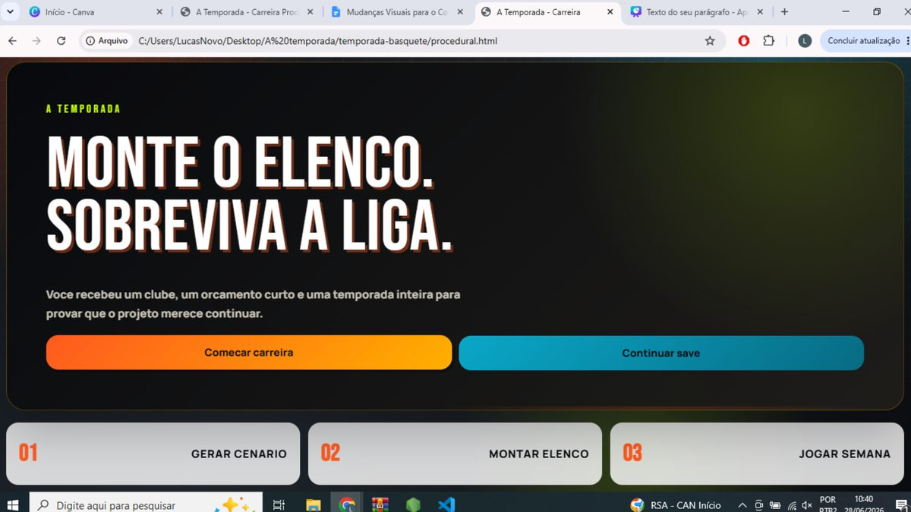
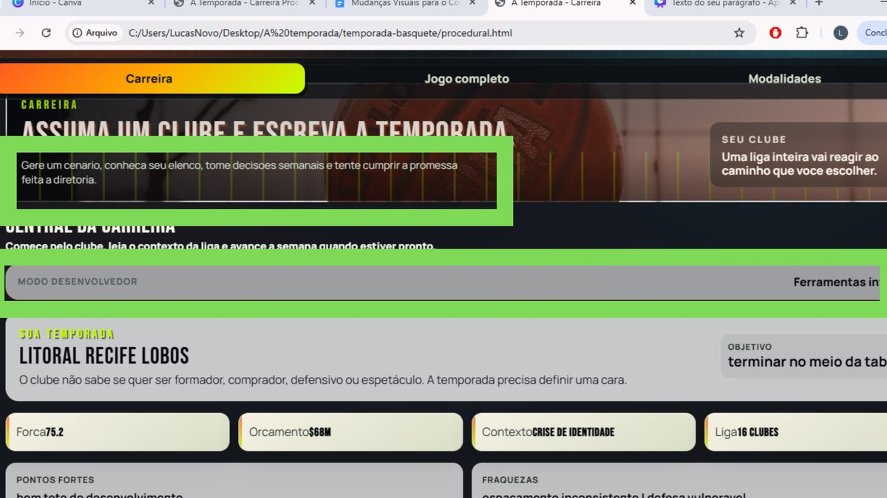
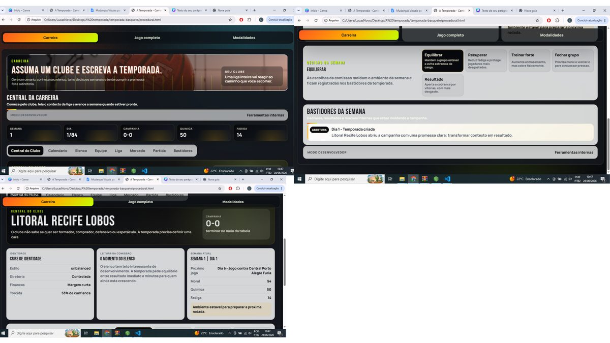
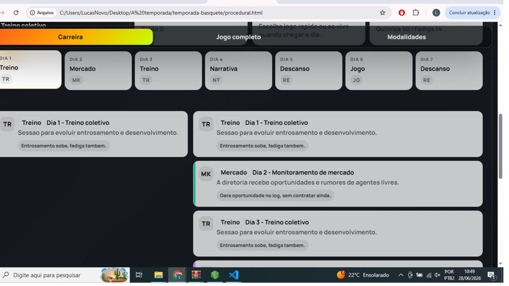
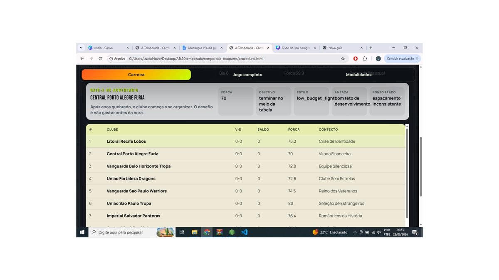
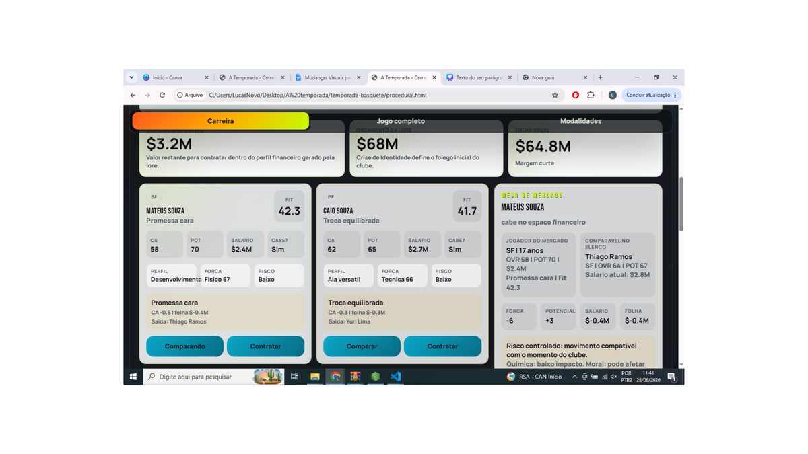

# Implementação - Carreira Procedural de Basquete

Documento para guiar alterações no modo **Carreira Procedural** do jogo **A Temporada**.

A intenção não é reescrever o jogo inteiro. A intenção é transformar o que já existe em uma experiência mais jogável, mais limpa e mais imersiva, sem quebrar o modo legado e sem misturar saves.

---

## Estado atual da implementação

- A carreira procedural existe em **basquete** e **vôlei**, usando módulos compartilhados em `shared/`.
- A carreira procedural agora possui uma entrada separada para **vôlei feminino**, reaproveitando o motor do vôlei com geração feminina e saves próprios.
- O modo legado continua separado do fluxo procedural.
- O save procedural usa chave própria e não deve ser misturado com o save antigo.
- Saves procedurais ficam separados entre basquete, vôlei masculino e vôlei feminino.
- A tela de seed permite prévia da liga, escolha do time controlado, edição de nome e personalização visual do escudo.
- O gerador de clubes usa identidade por esporte: nomes de vôlei não devem receber sufixos como "Basquete".
- A liga simula jogos do usuário e jogos paralelos dos outros clubes.
- A simulação ao vivo tem diferenças entre basquete e vôlei; no vôlei há rotação e impacto de decisões nos fundamentos.
- O banco procedural de decisões carrega `2000` decisões e o sorteio considera seed, esporte, clube, lore, objetivo e histórico para evitar trilhas clonadas.
- Decisões e jogos importantes aparecem como banners/overlays dentro da página, sem exigir troca de tela.

---

## 0. Referência visual principal

A tela abaixo é a referência estética para as próximas mudanças. Todas as novas telas devem se aproximar dela: fundo escuro, card grande, título forte, contraste alto, pouca explicação e sensação de jogo.



### Direção visual

- Usar títulos curtos e fortes.
- Evitar parágrafos longos na interface.
- Evitar textos que pareçam explicação de desenvolvimento.
- Usar cards grandes para decisões importantes.
- Usar cards pequenos para informações de consulta rápida.
- Priorizar uma tela jogável e limpa, não um painel de debug.
- Manter a estética esportiva, com cara de modo carreira.

---

## 1. Regra geral antes de começar

Antes de implementar qualquer tela nova, separar mentalmente três camadas:

1. **Dados internos**: podem continuar usando nomes técnicos no código.
2. **Tradução visual**: o jogador nunca deve ver termos crus como `low_budget_fight`, `unbalanced`, `fit`, `balanced_trade`.
3. **Interface final**: deve mostrar texto em português, curto e com tom de jogo.

### Critério de aceite

A interface final não deve exibir nenhuma chave interna em inglês.

---

## 2. Fazer backup e não mexer no modo legado

Antes de iniciar as mudanças:

- Preservar o jogo completo/legado.
- Preservar o save antigo.
- Preservar o fluxo atual caso a carreira procedural falhe.
- Implementar as mudanças de forma modular.

### Não fazer

- Não reescrever o projeto inteiro.
- Não misturar save procedural com save antigo.
- Não apagar funções antigas sem confirmar se ainda são usadas.
- Não alterar o modo legado para resolver problema do modo procedural.

### Critério de aceite

O botão do jogo completo continua funcionando como antes.

---

## 3. Limpar os textos da tela de escolha de modo

A tela atual tem textos artificiais demais, como se fossem recados para o desenvolvedor ou para o dono do projeto.


### Problema

Os textos marcados parecem explicar o projeto, não apresentar o jogo.

### Alteração

Substituir textos explicativos por frases curtas, em tom de jogo.

### Textos sugeridos

#### Carreira Procedural

**Título:** Carreira Procedural

**Subtítulo:** Um clube nasce da seed. A temporada, das suas escolhas.

**Descrição curta:** Gere uma liga, assuma um elenco e tente cumprir a promessa feita à diretoria.

**Botão:** Começar carreira

#### Jogo Completo

**Título:** Jogo Completo

**Subtítulo:** A experiência clássica da temporada.

**Descrição curta:** Entre no modo tradicional, com mercado, temporada e saves já consolidados.

**Botão:** Abrir jogo completo

#### Outras modalidades

**Título:** Outras modalidades

**Subtítulo:** Escolha outro esporte e jogue uma temporada própria.

### Critério de aceite

A tela de escolha deve parecer uma tela de jogo, não uma explicação do estado do projeto.

---

## 4. Criar um dicionário de rótulos para a interface

Criar uma função ou objeto central para traduzir termos internos para nomes de jogo.

### Exemplo de estrutura

```js
const UI_LABELS = {
  low_budget_fight: 'Orçamento curto',
  development_roster: 'Elenco em formação',
  unbalanced: 'Elenco irregular',
  veteran_core: 'Núcleo veterano',
  high_pressure: 'Pressão por resultado',
  selling_club: 'Clube vendedor',
  foreign_core: 'Base estrangeira',
  defensive_team: 'Defesa como identidade',
  fast_pace: 'Ritmo acelerado',
  young_promises: 'Promessas da base',
  balanced_trade: 'Troca possível',
  fit: 'Encaixe',
  risk_low: 'Risco baixo',
  risk_medium: 'Risco médio',
  risk_high: 'Risco alto'
};

function labelFor(value) {
  return UI_LABELS[value] || value;
}
```

### Regra

O código pode usar chaves técnicas. A tela não.

### Critério de aceite

Ao abrir liga, mercado, elenco e central da carreira, nenhum termo interno aparece para o jogador.

---

## 5. Criar tela intermediária de seed

Depois de clicar em **Começar carreira**, o jogo não deve entrar direto na temporada. Primeiro deve abrir uma tela de escolha e prévia da seed.

### Fluxo desejado

1. Jogador clica em **Começar carreira**.
2. Abre a tela **Escolha sua seed**.
3. Jogador pode digitar uma seed ou gerar seed aleatória.
4. O jogo mostra uma prévia do clube e da liga.
5. Jogador confirma se quer jogar aquela carreira.
6. Só depois disso o save procedural é criado.

### Elementos da tela

- Campo para digitar seed.
- Botão **Gerar seed aleatória**.
- Botão **Atualizar prévia**.
- Botão **Começar com esta seed**.
- Botão **Voltar**.

### Critério de aceite

A carreira só começa depois da confirmação do jogador.

---

## 6. Prévia do clube do jogador

A tela de seed deve ter um card grande para o clube que o jogador vai assumir.

### Conteúdo do card

- Nome do clube.
- Escudo provisório ou sigla.
- Cidade/região, se existir no gerador.
- Contexto narrativo.
- Objetivo da temporada.
- Força aproximada.
- Orçamento.
- Perfil do elenco.
- Relação com torcida.
- Relação com diretoria.

### Exemplo de texto

**Litoral Recife Lobos**

O clube chega à temporada sem uma identidade clara. A diretoria quer resultado, a torcida quer coragem e o elenco ainda procura uma cara.

**Objetivo:** terminar no meio da tabela  
**Contexto:** crise de identidade  
**Força:** 75  
**Orçamento:** $68M

### Critério de aceite

Trocar a seed muda o clube, o contexto, o orçamento e o objetivo.

---

## 7. Prévia da liga gerada

Além do clube do jogador, a tela de seed deve mostrar cards pequenos dos outros clubes da liga.

### Conteúdo de cada card

- Nome do clube.
- Escudo provisório ou sigla.
- Força.
- Contexto.
- Objetivo.
- Pequena frase narrativa.

### Exemplo

**Central Porto Alegre Furia**  
Força: 70  
Contexto: Virada financeira  
Objetivo: terminar no meio da tabela  
Frase: O clube começa a se organizar, mas ainda não pode errar antes da hora.

### Critério de aceite

A mesma seed sempre gera a mesma liga.

---

## 8. Expandir as lores para sustentar a tela de seed

A prévia da seed só vai ficar boa se os clubes tiverem histórias mais fortes.

### Cada lore deve influenciar

- Orçamento.
- Objetivo.
- Força inicial.
- Perfil do elenco.
- Pressão da torcida.
- Paciência da diretoria.
- Mercado.
- Bastidores.
- Decisões semanais.

### Lores iniciais sugeridas

#### Crise de identidade

O clube não sabe se quer formar atletas, comprar resultado ou jogar de forma defensiva. A temporada precisa definir uma cara.

Efeitos possíveis:

- Elenco irregular.
- Diretoria controladora.
- Torcida dividida.
- Mercado contraditório.
- Decisões sobre estilo de jogo.

#### Virada financeira

O clube começa a se organizar depois de anos difíceis. O desafio é não gastar antes da hora.

Efeitos possíveis:

- Orçamento curto.
- Pouca margem para multa.
- Objetivo modesto.
- Pressão por estabilidade.

#### Clube formador

A diretoria quer revelar atletas. Resultado importa, mas desenvolvimento pesa muito.

Efeitos possíveis:

- Mais jovens.
- Potencial alto.
- Força atual menor.
- Mercado barato.
- Decisões sobre minutos de promessas.

#### Última chance dos veteranos

O elenco tem experiência, mas a janela competitiva está fechando.

Efeitos possíveis:

- Força inicial mais alta.
- Fadiga maior.
- Potencial menor.
- Pressão por resultado imediato.

#### Torcida impaciente

O clube tem tradição e pouca paciência para reconstrução.

Efeitos possíveis:

- Moral oscila mais.
- Derrotas pesam mais.
- Diretoria cobra respostas rápidas.
- Decisões de bastidor mais frequentes.

#### Projeto silencioso

O clube não chama atenção, mas tem estrutura para crescer durante a temporada.

Efeitos possíveis:

- Pressão menor.
- Desenvolvimento estável.
- Objetivo intermediário.
- Boa margem para escolhas conservadoras.

---

## 9. Limpar a central da carreira

A central atual tem boas partes, mas também tem blocos que deixam a tela com cara de debug.



### Remover ou esconder

- Textos longos explicando o funcionamento.
- Faixas de “modo desenvolvedor”.
- Botões de ferramentas internas, exceto se estiverem atrás de uma opção de debug.
- Frases que repetem o que a própria tela já mostra.

### Manter visível

- Clube.
- Semana.
- Dia.
- Campanha.
- Moral.
- Química.
- Fadiga.
- Próximo jogo.
- Decisão pendente.
- Bastidores recentes.

### Critério de aceite

A central deve ser compreensível sem parecer uma tela de desenvolvimento.

---

## 10. Compactar o cabeçalho da carreira

As telas estão boas, mas o cabeçalho está grande demais e ocupa espaço jogável.



### Alteração

Transformar o cabeçalho em uma barra compacta.

### Conteúdo da barra

- Nome do clube.
- Semana e dia.
- Campanha.
- Moral.
- Química.
- Fadiga.
- Botão salvar.
- Botão avançar.

### Regra

O cabeçalho não deve empurrar o conteúdo principal para baixo a ponto de exigir muita rolagem.

### Critério de aceite

Em uma tela comum de notebook, o jogador deve ver a decisão da semana ou o resumo do clube sem precisar rolar muito.

---

## 11. Reorganizar a central como hub principal

A central precisa ser a tela onde o jogador entende a semana e toma decisões.

### Estrutura sugerida

#### Bloco 1 - Clube

- Nome do clube.
- Contexto.
- Objetivo.
- Leitura da comissão.
- Próximo jogo.

#### Bloco 2 - Decisão da semana

- Mostrar em destaque se houver decisão pendente.
- Se não houver decisão, mostrar preparação ou bastidor.

#### Bloco 3 - Semana

- Calendário compacto da semana.
- Dias com treino, mercado, descanso, narrativa e jogo.

#### Bloco 4 - Bastidores

- Registro curto dos acontecimentos recentes.
- Não transformar em mural gigante.

### Critério de aceite

A central deve responder rapidamente: “onde estou, o que está acontecendo e o que preciso decidir?”.

---

## 12. Simplificar o calendário

O calendário ficou bom visualmente, mas os textos longos atrapalham a experiência.



### Alteração

Cards do calendário devem ser curtos.

### Formato sugerido

#### Dia 1

**Treino**  
Dia reservado para treino.

#### Dia 2

**Mercado**  
Janela aberta.

#### Dia 3

**Treino**  
Preparação.

#### Dia 4

**Narrativa**  
Decisão disponível.

#### Dia 5

**Descanso**  
Recuperação.

#### Dia 6

**Jogo**  
Contra Central Porto Alegre Furia.

#### Dia 7

**Descanso**  
Recuperação.

### Regra

Não usar parágrafos dentro do calendário.

Descrições maiores só devem aparecer ao clicar no dia ou em um painel de detalhes.

### Critério de aceite

O calendário deve ser lido em poucos segundos.

---

## 13. Melhorar a aba da liga

A tela da liga já está boa. O foco aqui é polimento, não reconstrução.



### Ajustes

- Trocar termos internos por rótulos narrativos.
- Melhorar o card do adversário.
- Mostrar ameaça e ponto fraco com linguagem natural.
- Manter a tabela clara.

### Exemplo

Em vez de:

**Estilo:** low_budget_fight

Usar:

**Estilo:** orçamento curto

Em vez de:

**Ameaça:** bom teto de desenvolvimento

Usar:

**Ameaça:** jovens com margem de evolução

### Critério de aceite

A tela da liga deve parecer parte do universo do jogo, não um relatório técnico.

---

## 14. Criar escudos procedurais simples

Seria muito bom que cada clube tivesse um escudo. Não precisa começar com PNG nem imagem externa. A primeira versão pode ser SVG/CSS.

### Viabilidade

Implementar com SVG gerado pela seed.

### Componentes do escudo

- Forma base: círculo, escudo clássico, losango, escudo arredondado.
- Duas cores principais.
- Sigla do clube.
- Símbolo simples.
- Padrão: faixa diagonal, listra, borda dupla ou fundo dividido.

### Símbolos iniciais

- Bola.
- Estrela.
- Lobo.
- Dragão.
- Pantera.
- Raio.
- Coroa.
- Montanha.

### Regra

O escudo deve ser determinístico. A mesma seed gera o mesmo escudo.

### Critério de aceite

Cards de clube, tabela da liga e prévia da seed exibem escudos simples.

---

## 15. Melhorar o mercado sem decidir pelo jogador

O mercado está visualmente bom, mas ainda explica demais se uma troca é boa ou equilibrada.



### Problema

Frases como “troca equilibrada” ou “promessa cara” já interpretam a decisão pelo jogador.

### Alteração

O jogo deve mostrar dados e consequências. O jogador decide.

### Remover ou reduzir

- Troca equilibrada.
- Promessa cara.
- Cabe no espaço financeiro como julgamento definitivo.
- Qualquer texto que diga se a decisão é boa ou ruim.

### Mostrar no lugar

- Força atual.
- Potencial.
- Idade.
- Posição.
- Salário.
- Multa ou custo de saída.
- Impacto na folha.
- Comparação com atleta do elenco.
- Risco físico/técnico/financeiro.
- Efeito possível na moral, química e fadiga.

### Critério de aceite

O jogador precisa interpretar a contratação, não receber a resposta pronta.

---

## 16. Permitir que o jogador escolha quem liberar

Quando uma contratação exigir abrir espaço no elenco ou na folha, o jogador deve escolher quem será liberado.

### Fluxo desejado

1. Jogador clica em contratar.
2. Sistema verifica limite de elenco e folha.
3. Se for necessário liberar alguém, abre uma lista do elenco atual.
4. Jogador escolhe o atleta a liberar.
5. Sistema mostra custo de liberação/multa.
6. Jogador confirma ou cancela.

### Informações na lista de liberação

- Nome.
- Posição.
- Força.
- Potencial.
- Salário.
- Multa/custo de saída.
- Papel no elenco.
- Possível impacto na moral/química.

### Critério de aceite

O sistema não escolhe automaticamente quem sai quando a decisão deveria ser do jogador.

---

## 17. Implementar multa ou custo rescisório

Cada atleta deve ter um custo de saída.

### Cálculo sugerido

A multa pode considerar:

- Salário.
- Idade.
- Potencial.
- Força atual.
- Importância no elenco.
- Tempo de contrato.
- Contexto financeiro do clube.

### Fórmula simples inicial

```js
multa = salario * fatorContrato * fatorImportancia;
```

Onde:

- `fatorContrato` pode variar de 0.5 a 2.0.
- `fatorImportancia` pode variar conforme titularidade, força e potencial.

### Critério de aceite

Liberar jogador afeta orçamento ou folha de forma clara.

---

## 18. Variar o tamanho do elenco inicial

O elenco inicial não precisa ser fixo.

### Regra

- Mínimo: 12 atletas.
- Máximo: 15 atletas.
- A quantidade pode ser definida pela seed.
- A lore pode influenciar o tamanho.

### Exemplos

- Clube em crise financeira: tende a começar com 12 ou 13.
- Clube formador: pode começar com 14 ou 15, com mais jovens.
- Clube veterano: pode começar com 12 ou 13 atletas mais caros.
- Clube em pressão por resultado: pode começar com elenco mais forte, porém folha pesada.

### Critério de aceite

Diferentes seeds podem iniciar com tamanhos de elenco diferentes.

---

## 19. Ajustar decisões semanais

As decisões semanais devem parecer bastidores de temporada, não botões genéricos.

### Exemplo de decisão

**Decisão da semana: Equilibrar**

A comissão vê o grupo estável, mas sem crescimento claro. A semana permite escolher o tom da preparação.

Opções:

- Preservar o grupo.
- Treinar forte.
- Recuperar titulares.
- Fechar o elenco.

### Regra

Cada decisão deve ter consequência, mas não precisa explicar tudo de forma matemática para o jogador.

### Critério de aceite

A decisão deve parecer uma escolha de gestão, não uma tela de formulário.

---

## 20. Melhorar os bastidores

O bloco de bastidores deve registrar acontecimentos, mas sem ocupar a tela inteira.

### Formato sugerido

- Data curta.
- Tipo do evento.
- Texto curto.

### Exemplo

**Dia 1 - Abertura**  
Litoral Recife Lobos abriu a campanha com uma promessa clara: transformar contexto em resultado.

**Dia 4 - Bastidor**  
A comissão percebeu desgaste no grupo antes da próxima rodada.

### Critério de aceite

Bastidores devem dar vida à carreira sem poluir a interface.

---

## 21. Revisar navegação por abas

As abas são boas, mas precisam parecer parte de um modo carreira.

### Abas finais sugeridas

- Central
- Calendário
- Elenco
- Comissão
- Liga
- Mercado
- Partida
- Bastidores

### Regra

A aba ativa deve ser muito clara.

### Critério de aceite

O jogador deve saber onde está sem depender de rolagem ou texto explicativo.

---

## 22. Separar ferramentas internas de debug

Se houver ferramentas internas, elas não devem aparecer para o jogador comum.

### Solução sugerida

Criar um modo debug escondido, ativado por variável.

```js
const DEBUG_MODE = false;
```

Se `DEBUG_MODE` for falso:

- Esconder modo desenvolvedor.
- Esconder ferramentas internas.
- Esconder logs técnicos.

### Critério de aceite

A interface normal não exibe ferramentas de desenvolvimento.

---

## 23. Salvar carreira procedural separada

A carreira procedural precisa ter save próprio.

### Regras

- Não sobrescrever save do jogo completo.
- Salvar seed usada.
- Salvar semana, dia, elenco, liga, orçamento, moral, química, fadiga, bastidores e decisões tomadas.
- Permitir continuar carreira procedural.

### Critério de aceite

O jogador consegue começar uma carreira procedural, fechar o jogo e continuar depois.

---

## 24. Testes obrigatórios por seed

Depois de implementar, testar com pelo menos cinco seeds diferentes.

### Testar

- Seed gera sempre o mesmo clube.
- Seed gera sempre a mesma liga.
- Escudos se repetem corretamente na mesma seed.
- Elenco varia entre 12 e 15.
- Mercado respeita limite de folha e elenco.
- Save procedural não afeta modo legado.
- Nenhum termo interno aparece na tela.

### Seeds de teste sugeridas

- `teste001`
- `lobos-recife`
- `bh-projeto`
- `temporada-2026`
- `12345`

### Critério de aceite

Recarregar a mesma seed deve reconstruir a mesma base inicial.

---

## 25. Ordem recomendada de implementação

Implementar em blocos pequenos. Não fazer tudo em um único prompt.

### Bloco A - Limpeza imediata

- Trocar textos artificiais.
- Remover termos internos da interface.
- Esconder modo desenvolvedor.
- Reduzir textos longos.

### Bloco B - Tela de seed

- Criar tela intermediária.
- Campo de seed.
- Botão de seed aleatória.
- Prévia do clube.
- Prévia da liga.

### Bloco C - Central da carreira

- Cabeçalho compacto.
- Hub principal reorganizado.
- Decisão da semana em destaque.
- Bastidores curtos.

### Bloco D - Calendário

- Cards curtos.
- Descrições longas apenas em detalhes.
- Indicação de treino, mercado, narrativa, jogo e descanso.

### Bloco E - Liga

- Polir card do adversário.
- Traduzir estilos, ameaças e pontos fracos.
- Preservar tabela clara.

### Bloco F - Mercado

- Remover julgamentos prontos.
- Mostrar dados e riscos.
- Permitir escolher atleta liberado.
- Implementar multa/custo rescisório.

### Bloco G - Elenco procedural

- Variar elenco entre 12 e 15 atletas.
- Conectar tamanho do elenco à seed e à lore.
- Garantir posições mínimas.

### Bloco H - Escudos procedurais

- Implementar SVG/CSS simples.
- Gerar forma, cor, sigla e símbolo pela seed.
- Exibir em clube, liga, tabela e mercado quando fizer sentido.

### Bloco I - Save e QA

- Garantir save separado.
- Testar seeds.
- Testar modo legado.
- Conferir responsividade.

---

## 26. Prompt curto para usar com o Codex

Use este prompt quando for iniciar a implementação:

> Leia o arquivo `IMPLEMENTACAO_CARREIRA_PROCEDURAL.md` antes de alterar o código. Implemente as mudanças em blocos pequenos, começando pelo Bloco A. Não reescreva o projeto inteiro. Não quebre o modo legado. Não misture o save procedural com o save antigo. O objetivo é transformar a carreira procedural em uma experiência mais limpa, imersiva e jogável, usando a tela “MONTE O ELENCO. SOBREVIVA A LIGA.” como referência visual principal.

---

## 27. Critério final de sucesso

A implementação será considerada boa quando:

- O jogador conseguir escolher uma seed antes de iniciar.
- A seed mostrar uma prévia interessante do clube e da liga.
- A central da carreira parecer um hub de jogo.
- O calendário estiver limpo e rápido de ler.
- O mercado der dados, não respostas prontas.
- O jogador escolher quem liberar em uma contratação.
- O elenco variar proceduralmente entre 12 e 15 atletas.
- Os termos técnicos sumirem da interface.
- Os escudos procedurais aparecerem de forma consistente.
- O modo legado continuar funcionando.
- O jogo parecer menos protótipo e mais modo carreira.
