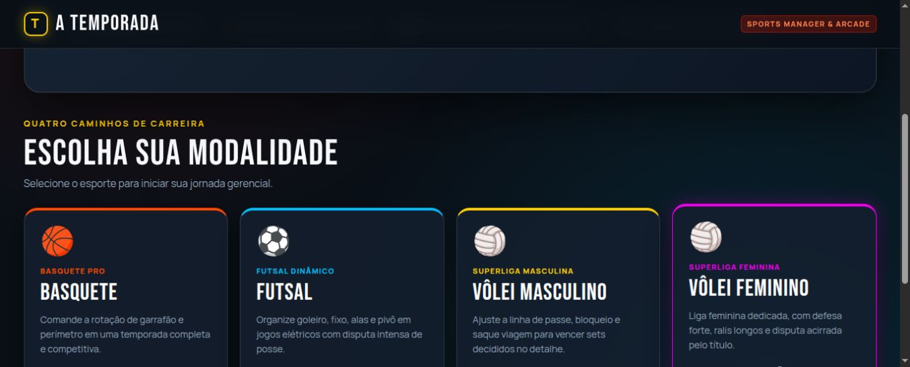
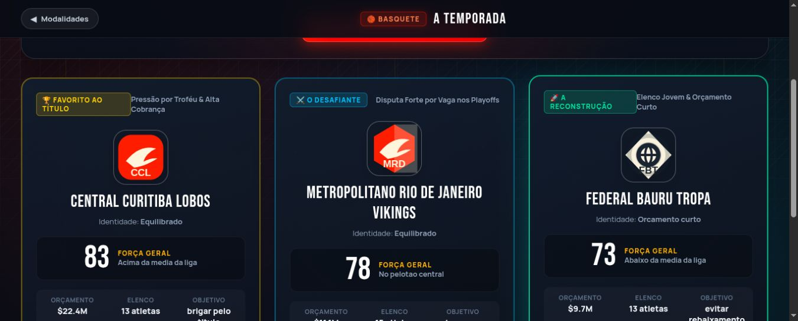

# A Temporada

Jogo de gestão esportiva para navegador, feito com HTML5, Canvas 2D, Web Audio API e JavaScript. Escolha uma modalidade, assuma um clube gerado proceduralmente e acompanhe a temporada entre decisões de gestão e minigames.

## Jogar

- [Abrir no GitHub Pages](https://lucaaregis4r-ops.github.io/a-temporada/)
- Para jogar localmente, abra [`Clique aqui para jogar.html`](Clique%20aqui%20para%20jogar.html) ou [`index.html`](index.html) em um navegador moderno. Não precisa instalar dependências.
- Se preferir, sirva a pasta com `npx serve .` ou `python3 -m http.server 8000`.

## Capturas

Capturas do site publicado em 21/10/2026.

| Escolha de modalidade | Contrato no basquete |
| --- | --- |
|  |  |

## Modalidades

| Esporte | Página |
|---|---|
| Basquete masculino | `temporada-basquete/procedural.html` |
| Futsal | `Temporada Futsal/procedural.html` |
| Vôlei masculino | `temporada-volei/procedural.html` |
| Vôlei feminino | `temporada-volei-feminino/index.html` |
| Natação (experimental) | `temporada-natacao/index.html` |

## Mecânicas

- Decisões no vestiário e na imprensa podem ter consequências dias depois. Resultados de clássicos também mudam os arcos da história. As escolhas afetam desempenho em quadra (`courtBoost`), moral, química, orçamento e evolução de jovens atletas. A aba **Crônicas & Decisões** acompanha os arcos ativos.
- Os minigames treinam arremesso, finalização e saque. Acertos podem somar até `+4.5` ao rating do time na partida seguinte, tanto na simulação rápida quanto no jogo ao vivo. Os efeitos sonoros usam Web Audio API.
- A central do clube reúne decisões pendentes, próximos jogos e o andamento da rotina. Também mostra indicadores de torcida, diretoria, caixa e vestiário.

## Desenvolvimento

As diretrizes de arquitetura, testes e inclusão de novas modalidades estão em [`AGENTS.md`](AGENTS.md).
